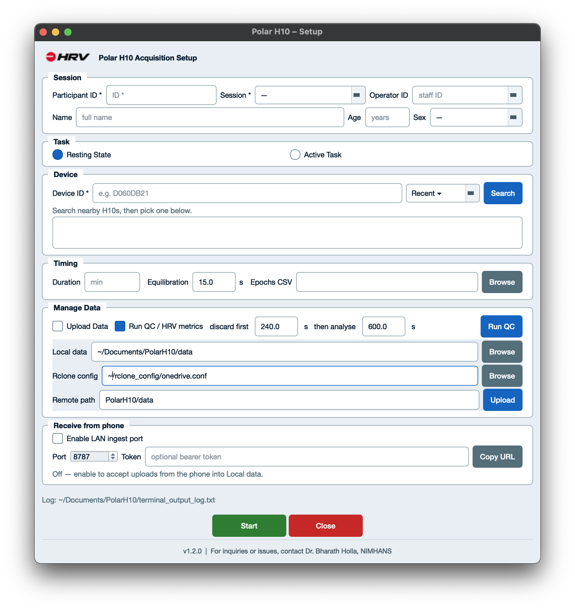
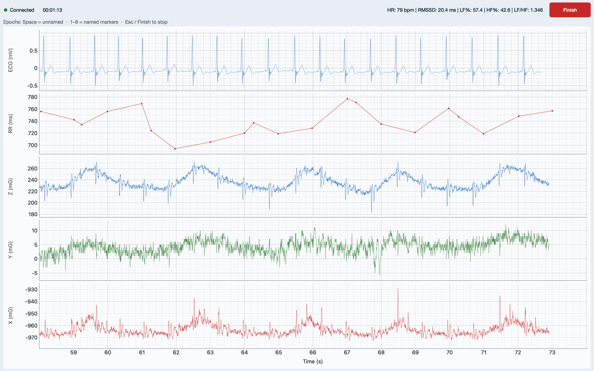
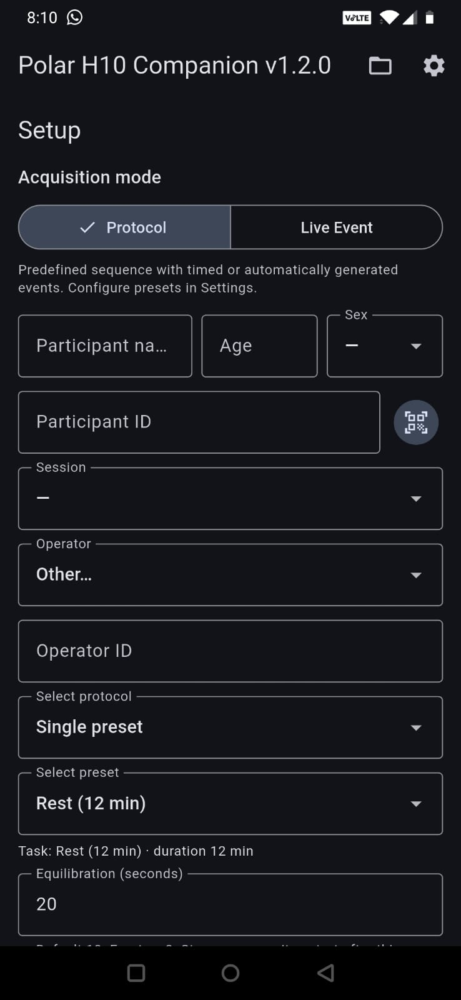
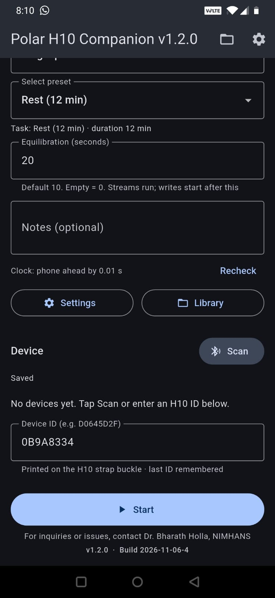
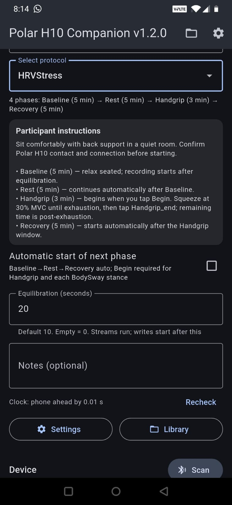
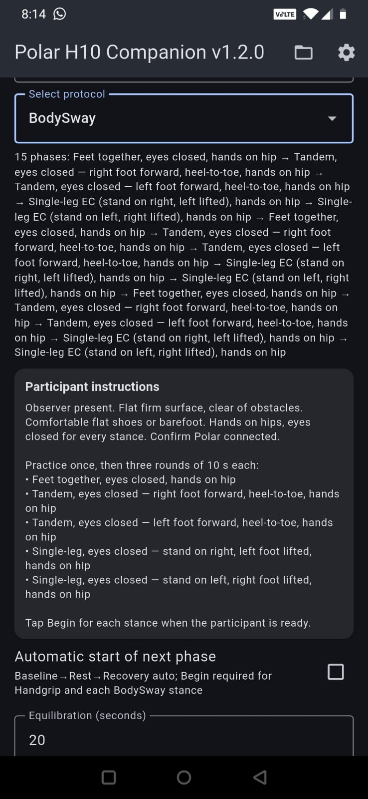
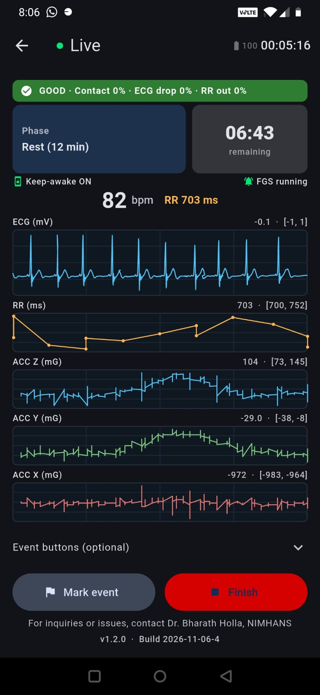
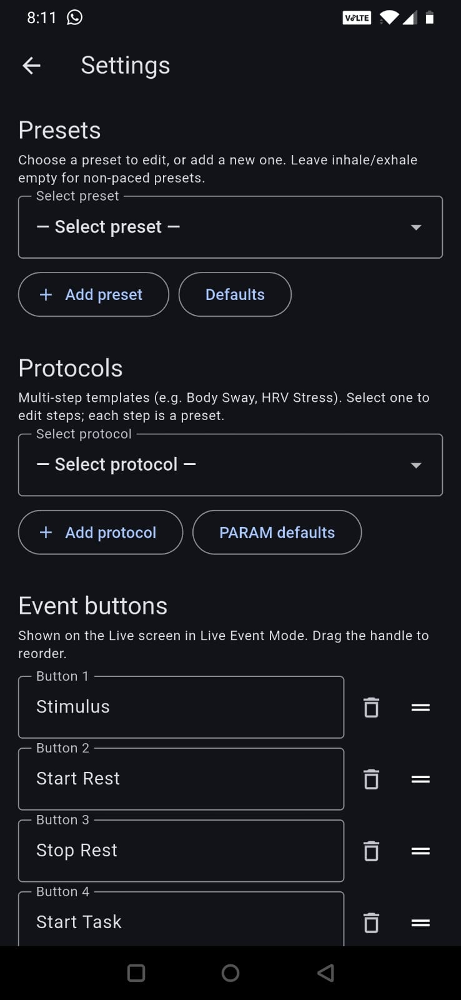
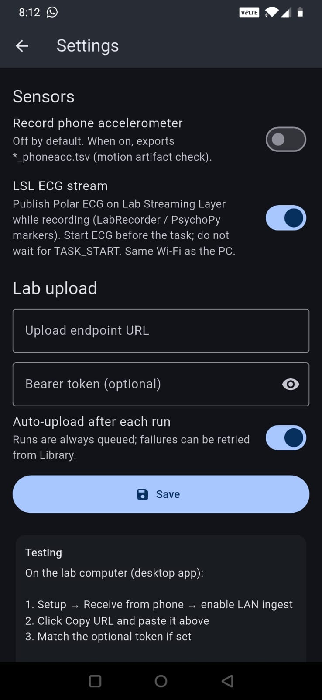
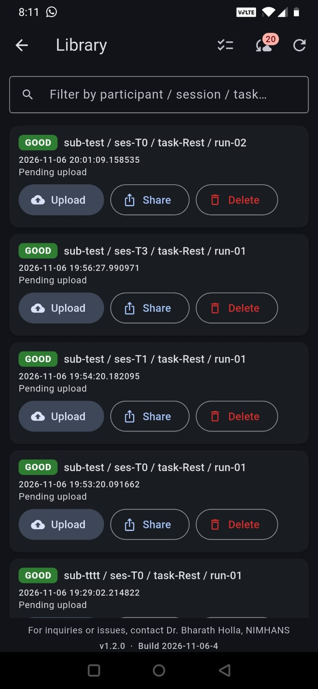

# Polar H10 Acquisition

<p>
  
</p>

Desktop + Android tools for **research-grade Polar H10** recording: live ECG / RR / acceleration, BIDS-style files, optional HRV QC, LSL ECG, and lab upload.

**Author:** Dr. Bharath Holla, NIMHANS

---

## Apps

| App | Platform | Role |
|-----|----------|------|
| **Polar H10 Acquisition** | macOS · Windows · Linux | Setup → stream & mark events → save → Run QC / Upload |
| **PARAM H10 Companion** | Android | Phone-side live recording; Share / LAN upload into desktop Local data |

### Downloads

Installers are on **[GitHub Releases](https://github.com/hollabharath/PolarH10-Tools/releases)** ([v1.2.0](https://github.com/hollabharath/PolarH10-Tools/releases/tag/v1.2.0) for current macOS / Linux / Android).

| Asset | Platform | Version |
|-------|----------|---------|
| `PolarH10Acquisition-v1.2.0.dmg` | macOS | **v1.2.0** |
| `PolarH10Acquisition-linux-v1.2.0.tar.gz` | Linux | **v1.2.0** |
| `PARAM_H10_Companion-v1.2.0.apk` | Android | **v1.2.0** |
| Windows `.exe` | Windows | **v1.1** (v1.2 build coming soon) |

(Local copies for testing may also exist under [`public_distro/`](public_distro/).)

---

## Desktop — Setup

Session metadata, device search, equilibration, QC window, rclone upload, and LAN ingest from the phone.



---

## Desktop — Live

Fullscreen ECG, RR, and ACC strips with live HRV (HR, RMSSD, LF%, HF%, LF/HF). `Space` / `1`–`9` mark epochs; **Finish** saves BIDS-style TSVs.



---

## Android companion

### Session & protocol setup

Choose **Protocol** or **Live Event**, enter participant / session / operator, pick a preset or named sequence, set equilibration, then connect the H10.

<p>
  
  &nbsp;
  
</p>

### SOP protocols (on-screen instructions)

Built-in **HRVStress** and **BodySway** sequences show phase lists and participant-facing SOP text. Handgrip and each sway stance wait for **Begin**; other HRV phases can auto-advance.

<p>
  
  &nbsp;
  
</p>

### Live recording

Quality strip, phase / remaining time, HR + RR, ECG and ACC traces, optional event buttons, **Mark event** / **Finish**. Keep-awake and foreground service stay on during the run.

<p>
  
</p>

### Settings — protocols & markers

Edit presets, multi-step protocols (PARAM defaults), and Live Event buttons.

<p>
  
</p>

### Settings — LSL & lab upload

Optional phone ACC export, **LSL ECG** (see [LSL ECG](#lsl-ecg-optional) below), and LAN upload to the desktop ingest URL.

<p>
  
</p>

### Library

Browse runs with QC grade, filter by participant / session / task, **Upload**, **Share** (BIDS zip), or delete. Batch select for multi-run share/upload.

<p>
  
</p>

**Typical flow:** Setup → **Start** → **Finish** → Library **Share** / upload → desktop Local data → **Run QC** / rclone **Upload**.

---

## Output (BIDS-style)

```text
data/sub-{id}/ses-{id}/
  sub-…_task-…_run-NN_ecg.tsv
  sub-…_task-…_run-NN_rr.tsv
  sub-…_task-…_run-NN_acc.tsv
  sub-…_task-…_run-NN_events.tsv
  sub-…_task-…_run-NN.json
  report_polar/                 # after desktop QC
```

Desktop data home: `~/Documents/PolarH10/data/`

---

## Quick start

1. Download the desktop build for your OS from **[Releases](https://github.com/hollabharath/PolarH10-Tools/releases)** — macOS / Linux from [v1.2.0](https://github.com/hollabharath/PolarH10-Tools/releases/tag/v1.2.0); Windows use the **v1.1** `.exe` until the v1.2 Windows build is posted (macOS: drag `.app` to Applications).
2. Grant **Bluetooth** when asked → Setup → **Start**.
3. Android: install the Companion APK from [v1.2.0](https://github.com/hollabharath/PolarH10-Tools/releases/tag/v1.2.0), pick protocol/device → **Start**.
4. Optional: desktop **Receive from phone** → copy URL into Companion Settings → Lab upload.

**macOS Gatekeeper** (unsigned research build): Control-click → Open, or  
`xattr -dr com.apple.quarantine /Applications/PolarH10Acquisition.app`

---

## LSL ECG (optional)

The Companion can publish Polar H10 **ECG on Lab Streaming Layer** while recording, so a lab PC on the **same Wi‑Fi** can time-lock ECG to task events (LabRecorder, PsychoPy markers, etc.).

**How it works**

- Settings → enable **LSL ECG stream** → start a normal recording (ECG must be streaming before the task; do not wait for `TASK_START`).
- Outlet name is typically `PolarH10_ECG` (float32 samples at the H10 ECG rate).
- Sample stamps are mapped from the Polar sensor clock into LSL time (estimate offset/drift; assign via a slowly updated map — not “whatever wall clock the packet arrived”).
- After Finish, a sidecar `*_lsl.tsv` (when present) records timing diagnostics for sync checks.

**Typical lab setup**

1. Phone and PC on the same Wi‑Fi (multicast / local discovery).
2. Companion: LSL ECG **on**, start recording.
3. PC: open [LabRecorder](https://github.com/labstreaminglayer/App-LabRecorder) and confirm `PolarH10_ECG` appears; optionally record a marker stream (e.g. PsychoPy → pylsl).
4. Example marker script: [`examples/psychopy_lsl_markers.py`](examples/psychopy_lsl_markers.py). Helper discovery / plot tools under [`lsl/`](lsl/).

LSL is independent of BIDS file export and of LAN/rclone upload — it is a live sync path for event-locked analysis.

---

## Upload (optional)

Packaged builds ship the **rclone binary**. Each lab / user creates a local `rclone.conf`.

### 1. Create an rclone remote

Official guide: **[rclone config](https://rclone.org/commands/rclone_config/)**  
Full list of storage backends: **[Supported providers](https://rclone.org/overview/)**

Common choices for labs:

| Provider | rclone type | Docs |
|----------|-------------|------|
| Google Drive | `drive` | [rclone.org/drive](https://rclone.org/drive/) |
| Microsoft OneDrive | `onedrive` | [rclone.org/onedrive](https://rclone.org/onedrive/) |
| Dropbox | `dropbox` | [rclone.org/dropbox](https://rclone.org/dropbox/) |
| S3 / compatible (AWS, MinIO, Wasabi, …) | `s3` | [rclone.org/s3](https://rclone.org/s3/) |
| SFTP / institutional server | `sftp` | [rclone.org/sftp](https://rclone.org/sftp/) |
| WebDAV (Nextcloud, ownCloud, …) | `webdav` | [rclone.org/webdav](https://rclone.org/webdav/) |

Interactive setup (recommended):

```bash
# Packaged app includes rclone; or use any rclone on PATH / after ./scripts/fetch_rclone.sh
rclone config --config=/absolute/path/to/rclone.conf
```

Follow the prompts: **n** (new remote) → name it (e.g. `labdrive`) → pick storage type → complete OAuth / keys.

### 2. Point this app at the conf

```bash
cp upload_config.example.json ~/Documents/PolarH10/upload_config.json
# edit:
#   rclone_config  = /absolute/path/to/rclone.conf
#   rclone_path    = PolarH10/data     # folder under the remote (not the whole drive)
```

Or in Setup → **Manage Data**: Browse to the conf, set **Remote path**, then **Upload** or tick **Upload Data** before **Start**.

The remote name is taken from the first `[section]` in `rclone.conf`. Uploads go to:

```text
<remote>:<rclone_path>/…
```

e.g. `labdrive:PolarH10/data/…`

### 3. Scope access — do not expose entire storage

Treat `rclone.conf` like a **password file**. It can hold OAuth tokens or keys that unlock far more than this study folder.

**When creating the remote**

- Prefer linking only a **dedicated folder** (or Shared Drive / Team folder), not the user’s entire cloud account.
- **Google Drive:** during config, set [`root_folder_id`](https://rclone.org/drive/#root-folder-id) so the remote’s `/` is that study folder only (see [Drive docs](https://rclone.org/drive/)).
- **OneDrive / Dropbox / S3:** create a project-specific folder or bucket and use that as the upload target; avoid granting app access to unrelated libraries when the provider offers a choice.
- **S3:** use a bucket (and IAM policy) limited to `PolarH10/*` (or similar), not `*`.

**In this app**

- Always set **Remote path** to a study folder (default `PolarH10/data`), never leave it empty if that would mean the remote root.
- Upload uses `rclone copy` into that path only (it does **not** delete other remote files).

**If you share a config with collaborators**

| Do | Don’t |
|----|--------|
| Share a remote scoped to a **lab/project folder** | Share a conf that can see a personal entire Drive/OneDrive |
| Prefer institutional / service accounts with least privilege | Commit `rclone.conf` or tokens to git / chat / email |
| Rotate tokens if a conf was shared too widely | Reuse a personal “full access” remote for multi-site studies |

Anyone with a copy of an unrestricted `rclone.conf` can typically **read and write** everything that remote can reach.

---

## License

MIT

## Acknowledgments

Polar H10 · [Bleak](https://github.com/hbldh/bleak) · NeuroKit2 · MNE · rclone · liblsl · BIDS-inspired naming
