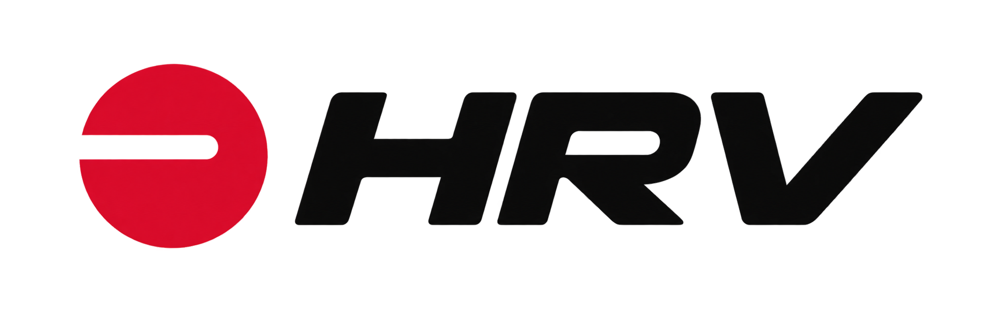
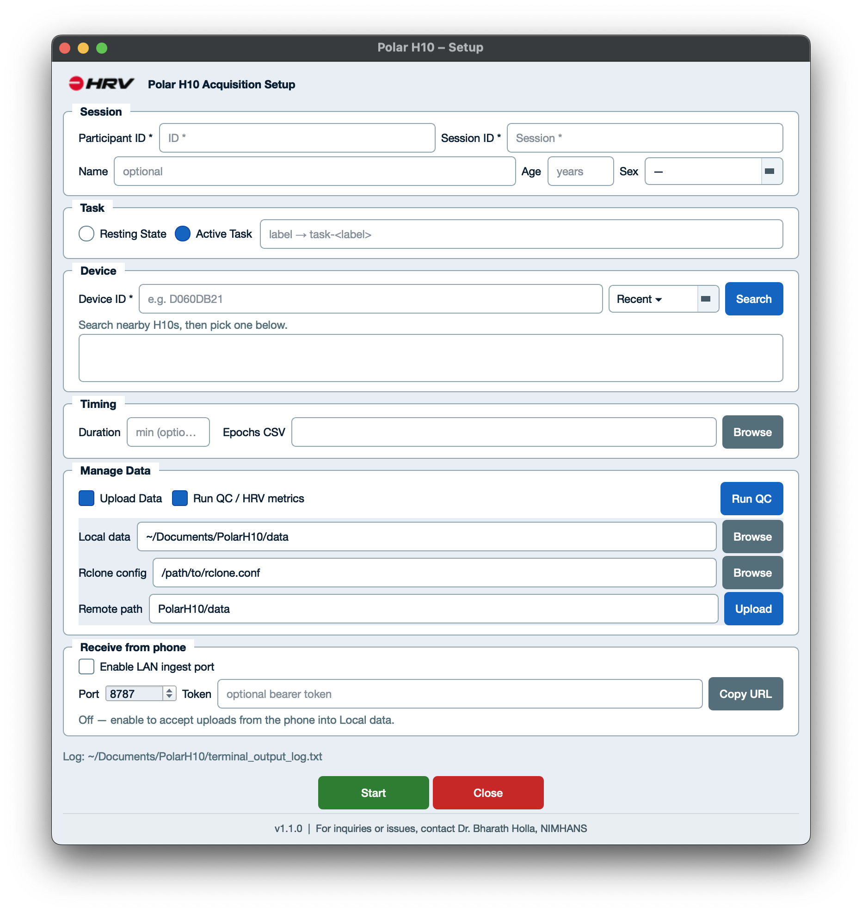
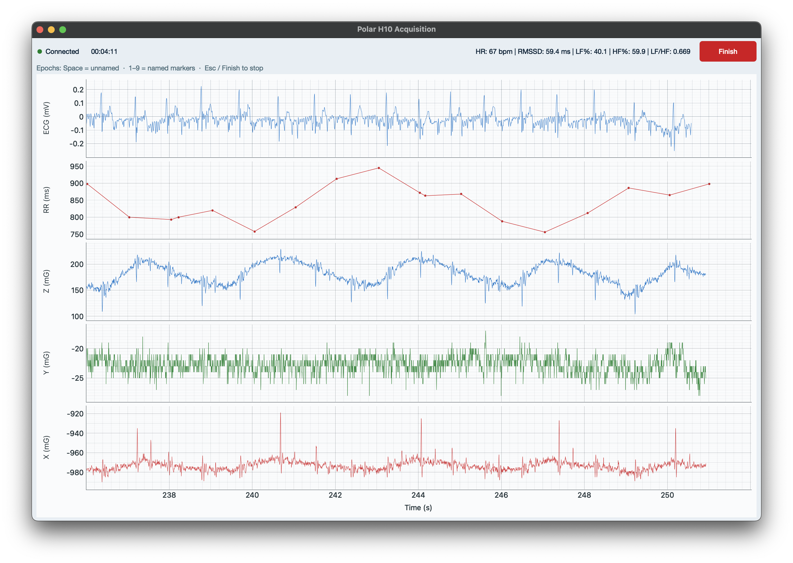
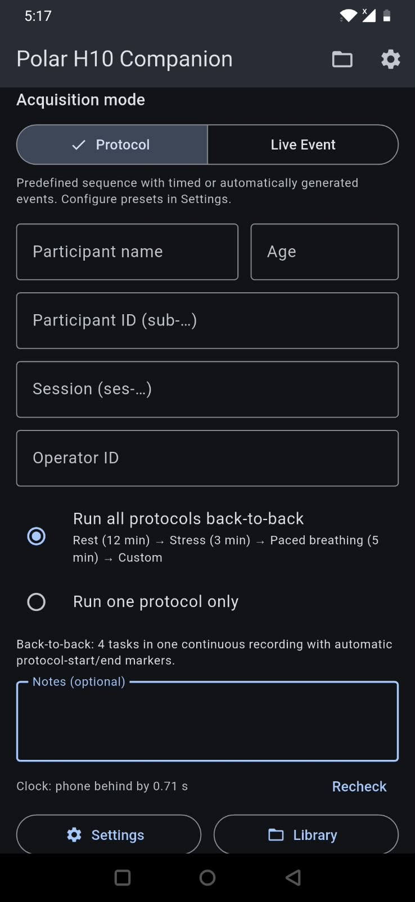
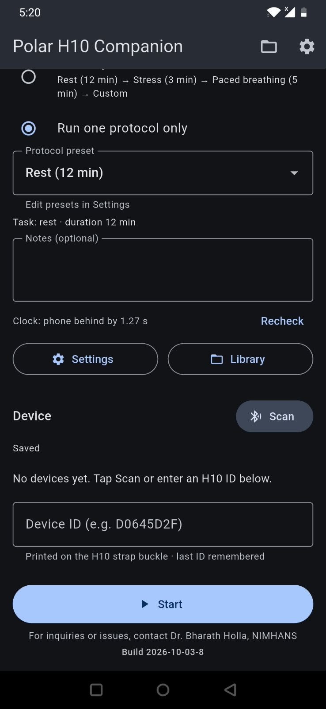
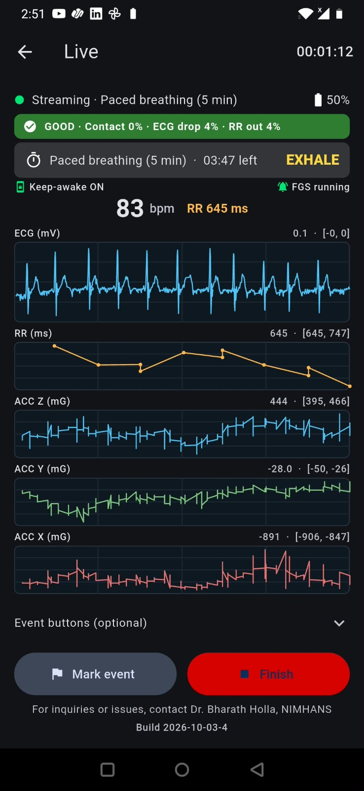
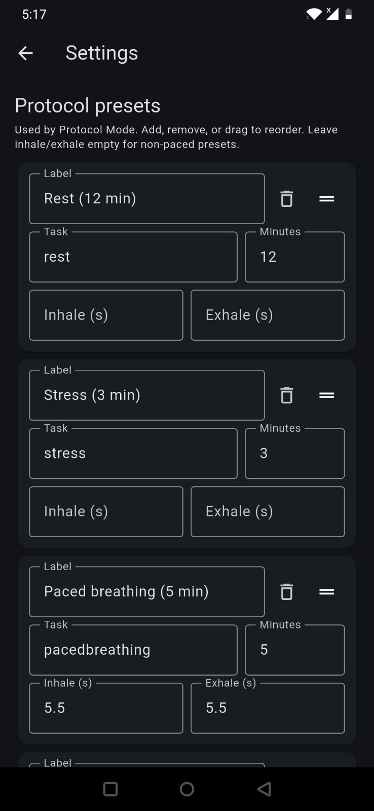
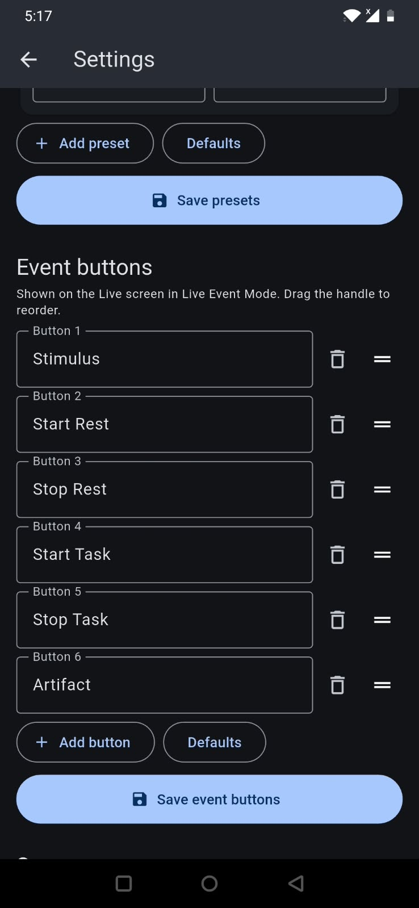
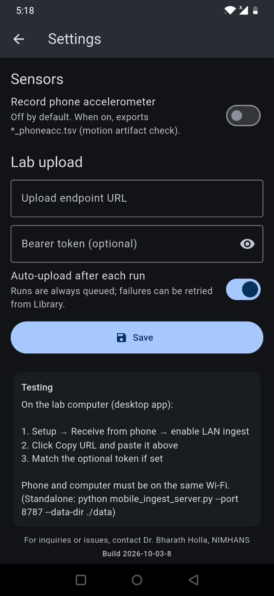
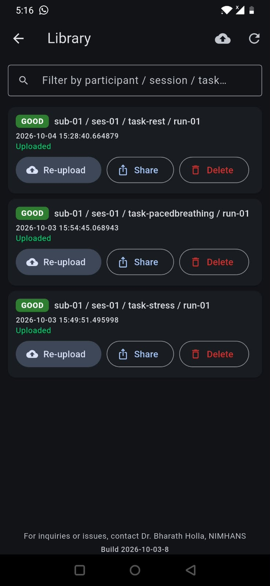

# Polar H10 Acquisition

<p>
  
</p>

Desktop + Android tools for **research-grade Polar H10** recording: live ECG / RR / acceleration, BIDS-style files, optional HRV QC reports, and cloud upload.

**Author:** Dr. Bharath Holla, NIMHANS 

---

## Apps

| App | Platform | Role |
|-----|----------|------|
| **Polar H10 Acquisition** | macOS · Windows · Linux | Setup session → stream & mark events → save → Run QC / Upload |
| **PARAM H10 Companion** | Android | Phone-side live recording; export into desktop Local data |

### Downloads (v1.1.0)

Installers are on **[GitHub Releases](https://github.com/hollabharath/PolarH10-Tools/releases)** (not in this repo — they exceed GitHub’s 100 MB git limit):

| File | Platform |
|------|----------|
| `PolarH10Acquisition-v1.1.0.dmg` | macOS |
| `PolarH10Acquisition-v1.1.0.exe` | Windows |
| `PolarH10Acquisition-linux-v1.1.0.tar.gz` | Linux |
| `PARAM_H10_Companion-2026-10-03-8.apk` | Android |

---

## Desktop — Setup

Configure participant / session / task, pick a Polar H10, optionally enable **Run QC / HRV metrics**, **Upload Data** (rclone), or **Receive from phone** (LAN ingest).



- Enter **Participant**, **Session**, optional **Name / Age / Sex**
- Choose **Resting State** or **Active Task**
- Set **Device ID** (Recent list or **Search**)
- Optional fixed **Duration** and **Epochs CSV** (named markers — example: [`hrv_markers.csv`](hrv_markers.csv))
- **Run QC** on existing Local data, or **Upload** without starting a recording
- Enable LAN ingest so the phone can push files into Local data

Example epochs CSV (`epoch_number` → keys `1`–`9` during recording):

```csv
epoch_number,epoch_name
1,Baseline
2,Rest
3,HG
4,Recovery
```

---

## Desktop — Live acquisition

Fullscreen stream with live HRV (HR, RMSSD, LF%, HF%, LF/HF). Finish stops and saves.



**During recording**

| Control | Action |
|---------|--------|
| `Space` | Unnamed epoch marker |
| `1`–`9` | Named epoch (from epochs CSV) |
| `Esc` / **Finish** | Stop and save |

**Streams**

- ECG (~130 Hz)
- RR intervals + instant HR
- Acceleration X / Y / Z (~200 Hz)

**After save (if enabled)**

- NeuroKit **QC PDF** + metrics CSV under `report_polar/`
- Optional **rclone** copy to your lab remote

Data home (packaged app): `~/Documents/PolarH10/data/`

---

## Android companion

Phone-side recording with protocol presets or live event markers, signal-quality strip, keep-awake / foreground service, Library export, and optional LAN upload to the desktop app. Same BIDS-like TSV layout for later QC.

### Setup

Protocol mode (timed sequence) or a single preset; participant / session fields; scan or enter H10 Device ID; then **Start**.

<p>
  
  &nbsp;
  
</p>

### Live

Rest and paced-breathing streams with quality badge, HR / RR, ECG + ACC strips, **Mark event** / **Finish**.

<p>
  
  &nbsp;
  
</p>

### Settings

Edit protocol presets (duration, optional inhale/exhale), Live Event buttons, and **Lab upload** (desktop LAN ingest URL + token).

<p>
  
  &nbsp;
  
  &nbsp;
  
</p>

### Library

Browse saved runs, **Share** / **Re-upload**, filter by participant / session / task.

<p>
  
</p>

**Typical flow:** Setup → **Start** → **Finish** → Library **Share** or auto-upload → desktop **Local data** → **Run QC** / **Upload**.

For LAN ingest: desktop Setup → **Receive from phone** → Copy URL → paste under companion Settings → Lab upload.

---

## Output (BIDS-style)

```text
data/sub-{id}/ses-{id}/
  sub-…_task-…_run-NN_ecg.tsv
  sub-…_task-…_run-NN_rr.tsv
  sub-…_task-…_run-NN_acc.tsv
  sub-…_task-…_run-NN_events.tsv
  sub-…_task-…_run-NN.json
  report_polar/                 # after QC
    <stem>_polar_indices.csv
    plots/<stem>_qc.pdf
```

---

## Quick start

### Packaged desktop

1. Download the build for your OS from **[Releases](https://github.com/hollabharath/PolarH10-Tools/releases)** (macOS: open the `.dmg` and drag the app to Applications).
2. Grant **Bluetooth** when asked.
3. Open the app → fill Setup → **Start**.
4. Optional: tick **Run QC / HRV metrics** and/or **Upload Data** (rclone).

**macOS Gatekeeper** (unsigned research build): Control-click → Open, or  
`xattr -dr com.apple.quarantine /Applications/PolarH10Acquisition.app`

### Android

Install the Companion `.apk` from **[Releases](https://github.com/hollabharath/PolarH10-Tools/releases)**.

---

## Upload (optional)

Packaged builds ship the **rclone binary**. Each lab / user creates a local `rclone.conf`.

### 1. Create an rclone remote

Official guide: **[rclone config](https://rclone.org/commands/rclone_config/)**  
Full list of storage backends: **[Supported providers](https://rclone.org/overview/)**

Common choices for labs:

| Provider | rclone type | Docs |
|----------|-------------|------|
| Google Drive | `drive` | [rclone.org/drive](https://rclone.org/drive/) |
| Microsoft OneDrive | `onedrive` | [rclone.org/onedrive](https://rclone.org/onedrive/) |
| Dropbox | `dropbox` | [rclone.org/dropbox](https://rclone.org/dropbox/) |
| S3 / compatible (AWS, MinIO, Wasabi, …) | `s3` | [rclone.org/s3](https://rclone.org/s3/) |
| SFTP / institutional server | `sftp` | [rclone.org/sftp](https://rclone.org/sftp/) |
| WebDAV (Nextcloud, ownCloud, …) | `webdav` | [rclone.org/webdav](https://rclone.org/webdav/) |

Interactive setup (recommended):

```bash
# Packaged app includes rclone; or use any rclone on PATH / after ./scripts/fetch_rclone.sh
rclone config --config=/absolute/path/to/rclone.conf
```

Follow the prompts: **n** (new remote) → name it (e.g. `labdrive`) → pick storage type → complete OAuth / keys.

### 2. Point this app at the conf

```bash
cp upload_config.example.json ~/Documents/PolarH10/upload_config.json
# edit:
#   rclone_config  = /absolute/path/to/rclone.conf
#   rclone_path    = PolarH10/data     # folder under the remote (not the whole drive)
```

Or in Setup → **Manage Data**: Browse to the conf, set **Remote path**, then **Upload** or tick **Upload Data** before **Start**.

The remote name is taken from the first `[section]` in `rclone.conf`. Uploads go to:

```text
<remote>:<rclone_path>/…
```

e.g. `labdrive:PolarH10/data/…`

### 3. Scope access — do not expose entire storage

Treat `rclone.conf` like a **password file**. It can hold OAuth tokens or keys that unlock far more than this study folder.

**When creating the remote**

- Prefer linking only a **dedicated folder** (or Shared Drive / Team folder), not the user’s entire cloud account.
- **Google Drive:** during config, set [`root_folder_id`](https://rclone.org/drive/#root-folder-id) so the remote’s `/` is that study folder only (see [Drive docs](https://rclone.org/drive/)).
- **OneDrive / Dropbox / S3:** create a project-specific folder or bucket and use that as the upload target; avoid granting app access to unrelated libraries when the provider offers a choice.
- **S3:** use a bucket (and IAM policy) limited to `PolarH10/*` (or similar), not `*`.

**In this app**

- Always set **Remote path** to a study folder (default `PolarH10/data`), never leave it empty if that would mean the remote root.
- Upload uses `rclone copy` into that path only (it does **not** delete other remote files).

**If you share a config with collaborators**

| Do | Don’t |
|----|--------|
| Share a remote scoped to a **lab/project folder** | Share a conf that can see a personal entire Drive/OneDrive |
| Prefer institutional / service accounts with least privilege | Commit `rclone.conf` or tokens to git / chat / email |
| Rotate tokens if a conf was shared too widely | Reuse a personal “full access” remote for multi-site studies |

Anyone with a copy of an unrestricted `rclone.conf` can typically **read and write** everything that remote can reach.

---

## License

MIT

## Acknowledgments

Polar H10 · [Bleak](https://github.com/hbldh/bleak) · NeuroKit2 · MNE (multitaper HRV in QC) · rclone · BIDS-inspired naming
